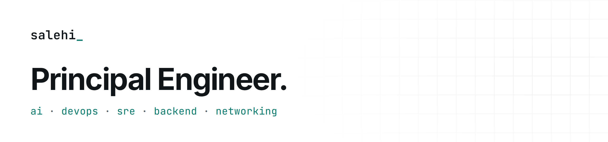
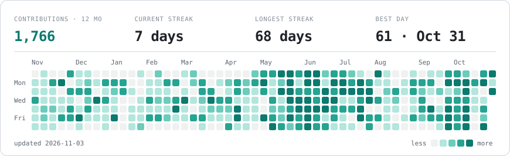

<a href="https://salehi.github.io">
  <picture>
    <source media="(prefers-color-scheme: dark)" srcset="assets/banner-dark.png">
    
  </picture>
</a>

10+ years building and operating production infrastructure across Linux, networking, containers, CI/CD, observability, backend systems and distributed network tooling.

**[Website](https://salehi.github.io)** · **[Résumé](https://salehi.github.io/cv/)** · **[LinkedIn](https://www.linkedin.com/in/s4l3h1)** · **[Email](mailto:salehi1994@gmail.com)** · **[Docker Hub](https://hub.docker.com/u/s4l3h1)**

### Activity

<picture>
  <source media="(prefers-color-scheme: dark)" srcset="assets/graph-dark.svg">
  
</picture>

#### Latest public activity

<!-- activity:start -->
- `Oct 29` Commented on [#646](https://github.com/vyuldashev/laravel-queue-rabbitmq/pull/646#issuecomment-6507318077) in [vyuldashev/laravel-queue-rabbitmq](https://github.com/vyuldashev/laravel-queue-rabbitmq)
- `Oct 16` Pushed 2 times to [meshcheck-android](https://github.com/salehi/meshcheck-android)
- `Oct 16` Pushed to [meshcheck-agent](https://github.com/salehi/meshcheck-agent)
- `Oct 14` Pushed to [meshcheck-android](https://github.com/salehi/meshcheck-android)
- `Oct 12` Pushed 5 times to [tavazon](https://github.com/salehi/tavazon)
- `Oct 3` Pushed to [mailer](https://github.com/salehi/mailer)
- `Oct 2` Pushed to [android-emulator-farm](https://github.com/salehi/android-emulator-farm)
- `Jan 1` Closed PR [#646](https://github.com/vyuldashev/laravel-queue-rabbitmq/pull/646) in [vyuldashev/laravel-queue-rabbitmq](https://github.com/vyuldashev/laravel-queue-rabbitmq)
<!-- activity:end -->

### Favorite projects

<table>
<tr><td width="50%" valign="top"><a href="https://github.com/salehi/s3proxy_lua"><b>s3proxy_lua</b></a> <code>Lua</code> High-throughput S3 signature proxy on OpenResty: validates client SigV4 and re-signs for origin S3</td><td width="50%" valign="top"><a href="https://github.com/salehi/s3proxy"><b>s3proxy</b></a> <code>Python</code> Serve S3 under another domain with per-backend SigV4 re-signing and health-checked failover</td></tr>
<tr><td width="50%" valign="top"><a href="https://github.com/salehi/ParsiAnalyzer"><b>ParsiAnalyzer</b></a> <code>Java</code> Persian text-analysis plugin for Elasticsearch: normalization, stemming, lemmatization</td><td width="50%" valign="top"><a href="https://github.com/salehi/arvancloud_to_cloudflare"><b>arvancloud_to_cloudflare</b></a> <code>Python</code> Migrate ArvanCloud DNS to a Cloudflare import file, as a CLI or in the browser</td></tr>
<tr><td width="50%" valign="top"><a href="https://github.com/salehi/bazaar-dl"><b>bazaar-dl</b></a> <code>JS</code> Resolve Cafe Bazaar app links to direct APK downloads</td><td width="50%" valign="top"><a href="https://github.com/salehi/digipay"><b>digipay</b></a> <code>JS</code> DigiPay UPG lifecycle sandbox: browser stepper plus a stateless Cloudflare Worker</td></tr>
<tr><td width="50%" valign="top"><a href="https://github.com/salehi/enamad"><b>enamad</b></a> <code>Python</code> Scrape Iran’s enamad.ir trust-seal registry into a searchable table</td><td width="50%" valign="top"><a href="https://github.com/salehi/netscope"><b>netscope</b></a> <code>Python</code> Self-hosted GeoIP and network intelligence: IP, ASN, country, CIDR lookups</td></tr>
<tr><td width="50%" valign="top"><a href="https://github.com/salehi/android-emulator-farm"><b>android-emulator-farm</b></a> <code>Docker</code> Headless Android emulators in Docker, one image per API level 24–36</td><td width="50%" valign="top"><a href="https://github.com/salehi/mailer"><b>mailer</b></a> <code>Go</code> Send-only SMTP relay with DKIM, SPF and DMARC in a 7.5 MB scratch image</td></tr>
<tr><td width="50%" valign="top"><a href="https://github.com/salehi/tavazon"><b>tavazon</b></a> <code>Go</code> Keep an asymmetric hosting quota in balance with shaped, distributed traffic</td><td width="50%" valign="top"><a href="https://github.com/salehi/meshcheck-android"><b>meshcheck-android</b></a> <code>Kotlin</code> MeshCheck Android peer-node contributor app</td></tr>
<tr><td width="50%" valign="top"><a href="https://github.com/salehi/meshcheck-agent"><b>meshcheck-agent</b></a> <code>Go</code> MeshCheck node agent: ping/TCP/HTTP/DNS/TLS/SMTP probes with signed results</td><td width="50%" valign="top"><a href="https://github.com/salehi/nginx-cors-gate"><b>nginx-cors-gate</b></a> <code>Nginx</code> Nginx CORS gateway that actually blocks unauthorized origins</td></tr>
<tr><td width="50%" valign="top"><a href="https://github.com/salehi/certbot-dns-arvancloud"><b>certbot-dns-arvancloud</b></a> <code>Python</code> Certbot DNS-01 plugin for ArvanCloud wildcard certificates</td><td width="50%"></td></tr>
</table>

Heatmap and activity refresh automatically every 6 hours.
